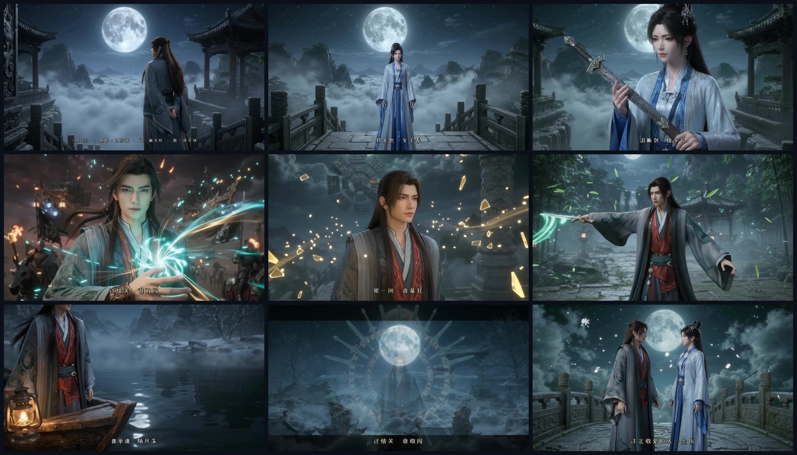

# Google Antigravity × Google Flow 全自动 AI 音乐 MV 制作复现指南（720P 经济高质版）

> **成片实拍九宫格预览**（《月光》4 分 32 秒 · 3D 国漫风 · 全片由 Antigravity 内置 Browser Agent 控制 Google Flow 首尾帧连贯生成 + Demucs & stable-ts 精准对齐底部精装字幕）：



本指南完整记录了如何在 **Windows 或者 macOS** 上，利用 **Google Antigravity 独立桌面 App 内置 Browser Agent** + **仅使用现有 Google AI Pro会员或者Ultra 20× 网页会员权益（Google Flow）** + **开源人声歌词强制对齐（Demucs + stable-ts）** + **本地 FFmpeg 硬件剪辑**，从零配置到自动产出一部 **4 分 32 秒、双主角高度锁定、首尾帧连贯、字幕毫秒级精准对齐** 的完整 3D 国漫风音乐 MV。

> [!IMPORTANT]
> **核心铁律（零额外付费 & 拒绝超分浪费）**
> 1. **仅使用现有 Google AI Pro会员或者Ultra 20× 网页会员权益**：严禁调用任何独立计费 API（Gemini API / Veo API / Lyria API / Vertex AI API），严禁绑定 GCP 计费或购买额外积分。
> 2. **Flow 生成与下载统一锁定 `720p Original size`，严禁使用 Flow 超分辨率（不要点 `1080p Upscaled` 或 `4K Upscaled`）**：
>    - `720p Original size` 下载**额外消耗 `0` 积分**、下载更快、无需等待云端超分队列；
>    - 避免单段视频 1～5 积分（1080p）或 50 积分（4K）的额外超分开销；
>    - 后续在本地 FFmpeg 剪辑阶段统一按目标画幅封装并烧录矢量级高清 `.ass` 字幕，观感依然锐利清晰。
> 3. **安全合规**：不导出 Cookie、不自动填密码、不绕过官方 5 小时/并发配额；登录与首次上传角色图均按 Antigravity 安全机制由人工一次性完成。

---

## 一、环境与工具前置要求

| 组件 | 推荐版本 / 要求 | 用途 |
| :--- | :--- | :--- |
| 操作系统 | Windows 10/11 或 macOS（Apple Silicon M 系列推荐） | Windows 支持 NVIDIA CUDA/NVENC，macOS 支持 VideoToolbox/MPS（无独显亦可 CPU 运行） |
| Google Antigravity App | `v2.30.0+`（个人 Google AI Pro 或 Ultra 20× 账号） | 提供内置侧边栏浏览器与 `browser` subagent |
| Google 服务 | `https://gemini.google.com/`、`https://flow.google.com/` | 网页端音乐与视频生成（仅使用现有 Google AI Pro会员或者Ultra 20× 网页会员权益） |
| 本地媒体工具 | `ffmpeg`（需启用 `libass` / `libfreetype`）、`ffprobe` | 视频拼接、`xfade` 转场、音画合成、字幕烧录 |
| Python 环境 | `Python 3.11+` + `uv`（或 `venv`） | 运行工程脚本与 Demucs / stable-ts 歌词强制对齐 |

### 1.1 检查本地媒体工具（终端执行）

```bash
ffmpeg -version | head -n 3
ffprobe -version | head -n 2
# 确认支持 libass 字幕渲染与 Apple Silicon 硬件编码
ffmpeg -filters 2>/dev/null | grep -E "ass|xfade|afade"
ffmpeg -encoders 2>/dev/null | grep -E "h264_videotoolbox|libx264|aac"
```

---

## 二、配置 Antigravity 内置 Browser Agent 与登录 Google Flow

### 2.1 确认内置浏览器后端已启用
1. 打开 **Antigravity App → Settings → Browser**。
2. 在 **Browser Subagent → Browser Actuation Rules** 中确认显示内置浏览器（无需安装或配置外部 Chrome Remote Debugging）。
3. 推荐预先配置最小权限规则（或在首次弹窗时选择永久允许）：
   - **Execute URLs**：允许 `gemini.google.com`、`flow.google.com`
   - **Download files**：允许 `flow.google.com`

### 2.2 手动登录 Google 账号与 Flow（安全隔离规范）
Antigravity 内置安全护栏**禁止** Browser Agent 操作 `accounts.google.com` 登录页。标准做法：
1. 在 Antigravity 右侧内置浏览器标签页中手动打开 `https://gemini.google.com/`，登录你的 Google AI Pro 或 Ultra 20× 账号（确认侧边栏显示 `Pro` 或 `Ultra` 标识）。
2. 再打开 `https://flow.google.com/` 完成授权登录，确认进入 Flow 首页并显示对应的 **`PRO` / `ULTRA` tier** 与可用月度积分余额。
3. 在 Flow 右上角 **Account Settings** 中检查 **`Visible watermarking`** 设为 **`OFF`**（关闭可见水印）。

---

## 三、建立本地项目结构与安装 Skill

### 3.1 统一项目目录规范

建议在 `~/Movies/Antigravity-MV/` 下管理全部 MV 工程：

```text
~/Movies/Antigravity-MV/
├── projects/
│   └── <project-slug>/
│       ├── music/              # 原唱音频（MP3/M4A/WAV）
│       ├── lyrics/             # 歌词文本、对齐 JSON、.lrc 与 .ass 字幕
│       ├── references/         # 主角参考图、character_sheet.md、字幕字体（fonts/）
│       ├── storyboard/         # 结构化分镜 storyboard.json
│       ├── prompts/            # 可读版 Flow 提示词汇总 flow_prompts.md
│       ├── clips/              # 从 Flow 下载的 720p 原始片段（shot_001.mp4 ...）
│       ├── previews/           # 样片与抽帧质检截图（qa_frames/）
│       ├── output/             # 最终合成的 MV 成片
│       ├── logs/               # 对齐脚本、渲染脚本与执行日志
│       └── progress.json       # 全流程断点续传账本
└── tools/
    └── align-venv/             # 独立隔离的 Demucs + stable-ts Python 虚拟环境
```

### 3.2 安装全局 Skill

将本仓库附带的 `SKILL.md` 复制到 Antigravity 全局 Skill 目录（或项目内 `.agents/skills/`）：

```bash
mkdir -p ~/.gemini/config/skills/ultra-mv-studio
cp SKILL.md ~/.gemini/config/skills/ultra-mv-studio/SKILL.md
```

新开一个 Antigravity 对话即可通过输入 **`/ultra-mv-studio`** 或自然语言自动触发。

---

## 四、Google Flow 模型选型与 `720p` 积分经济学

在 Flow 项目内（`Video` 模式）实测常见模型对比（均以 **`720p`、`x1`、不超分** 计算）：

| 模型 | 单段时长 | `720p` 生成积分 | `720p` 下载附加费 | 适用场景 |
| :--- | :--- | :--- | :--- | :--- |
| **`Omni 1.2 Flash`（主力推荐）** | `3s`–`15s`（1s 步进） | `3s–10s`：**3 积分/秒**（10s = 30）；`11s–15s`：超出 10s 部分 **6 积分/秒**（15s = 60） | **`0` 积分**（严禁点 1080p/4K 超分） | 主打角色与场景一致性、跳切最少，最适合多段连贯 MV |
| `Veo 3.1 - Lite [Lower Priority]` | `4s`–`8s` | **`0` 积分**（低优先级排队） | **`0` 积分** | 零积分预算方案、空镜/风景过渡 |
| `Veo 3.1 - Lite` | `4s`–`8s` | 固定 `5` 积分/段 | **`0` 积分** | 低成本快速测试 |

> [!TIP]
> **省积分实战公式（以 4 分 32 秒 / 272 秒 MV 为例）**：
> - 采用 **`Omni 1.2 Flash`（`720p`，`x1`，`720p Original size` 下载）**：
>   - **混合 10s–15s 乐句切片（25 段）**：总计 **`1,032` 积分**（零超分费）。
>   - **极致性价比全 `10s` 切片（28 段）**：因为 `10s` 刚好卡在 3 积分/秒的拐点，总计仅需 **`28 × 30 = 840` 积分**！

---

## 五、分镜设计、角色锁定与 Flow 批量首尾帧生成

### 5.1 角色设定与画风锚点（`references/character_sheet.md`）
1. 将主角参考图（如男主正面图 + 女主三视图）存入 `references/`。
2. 提炼高度具体的**非敏感视觉锚点（Character Anchor）**（脸型骨相、发饰、发色、外袍刺绣纹样、内衫颜色、腰带配饰）与**统一画风前缀**（例如参考 3D 国漫《凡人修仙传》UE5 Nanite 古建 + Lumen 实时冷月全局光 + 写实织物金属质感）。
3. **每条 Flow 提示词末尾务必加上**：`no text, no watermark, no subtitles.` —— 禁止 AI 模型直接画中文字幕，避免乱码闪烁。

### 5.2 规避浏览器沙箱限制的两个核心工程技巧

1. **一次性手动上传主角参考图（解决 `setInputFiles` 拦截）**
   - Antigravity 安全策略会拦截代理向 `flow.google.com` 自动执行本地文件上传。
   - **解法**：由 Browser Agent 新建专属 Flow 项目后，**用户只需手动将主角参考图一次性拖入该 Flow 项目画布（约 5 秒）**。图片进入项目 `Uploads` 库后，后续全部 25～28 段视频的参考图挂载和尾帧衔接均在 Flow 内部完成，**全程不再需要任何本地上传**。
2. **提示词落盘至 `browser_sandbox/references/`（防长对话截断）**
   - 将全部镜头的完整提示词写入 `<ArtifactDir>/browser_sandbox/references/all_shots.md`。
   - 每次只向 `browser` subagent 下发 **3～5 段为一批**的简短指令，让子代理通过 `read_file` 读取精确提示词，彻底避免上下文压缩导致 Prompt 截断。

### 5.3 首尾帧丝滑衔接标准操作（Flow 内部闭环）

对每一批中的每个镜头（严格按顺序逐段执行）：
1. 模式设为 **`Video` → `Ingredients`**，模型 **`Omni 1.2 Flash`**，画幅 **`16:9`**，分辨率 **`720p`**，数量 **`x1`**。
2. **挂载 Ingredients**：
   - 第 1 段：挂载主角参考图（如男主图）。
   - 第 `N` 段（`N ≥ 2`）：挂载 **(1) 第 `N-1` 段保存的尾帧** + **(2) 本段出镜的男/女主原始参考图**（既锁住首尾构图与光影过渡，又防止多段后人物脸型漂移）。
3. 填入该段时长（如 `10s`～`15s`）与提示词，点击生成并等待完成。
4. 点击生成的视频进入 Flow **Video Editor**：
   - 将时间轴拖至**最后一帧** → 点击 **`Save frame`**（把尾帧存入项目素材库，供下一段直接调用）。
   - 点击 **Download → `720p Original size`**（**严禁点击 `1080p Upscaled` 或 `4K Upscaled`**！）。
5. 每批（3～5 段）完成后，立即在本地：
   - 将下载的 MP4 复制归档为 `clips/shot_XXX.mp4`；
   - 用 `ffprobe` 校验分辨率（`1280×720`）、时长与文件非空（及时发现漏下载）；
   - 更新 `progress.json` 实现断点续传。

---

## 六、开源人声分离 + 逐字强制对齐（实现毫秒级精准歌词字幕）

直接套用网上下载的 LRC 时间轴，常会因音频前奏剪辑差异导致 **3～6 秒的整体提前或延迟**，而纯靠 Whisper 识别带鼓点/吉他的完整混音又容易把歌词听错或漏句。

最佳实践是使用 GitHub 开源两步法：**[`facebookresearch/demucs`](https://github.com/facebookresearch/demucs) + [`jianfch/stable-ts`](https://github.com/jianfch/stable-ts) + 10ms 纯人声 RMS 能量精修**。

### 6.1 创建独立对齐环境（使用 `uv`）

```bash
mkdir -p ~/Movies/Antigravity-MV/tools
uv venv --python 3.11 ~/Movies/Antigravity-MV/tools/align-venv
uv pip install --python ~/Movies/Antigravity-MV/tools/align-venv/bin/python \
  stable-ts demucs soundfile scipy
```

### 6.2 三步精准对齐流程

1. **Step 1：Demucs 提取纯干声人声（`htdemucs`）**
   - 将原唱音频转为 44.1kHz WAV，调用 `htdemucs`（Apple Silicon 自动开启 MPS GPU 加速）分离出 `vocals` 干声轨，彻底剥离鼓点、电吉他与管弦伴奏。
   - 导出 16kHz 单声道 `vocals_16k.wav` 供 Whisper 对齐使用。
2. **Step 2：定位真实人声段落 + 分段强制对齐（`stable-ts`）**
   - 先扫描纯人声轨的静默间隙（> 2.5s）并运行一次快速转写，确定真实的主歌 / 副歌 / 间奏边界（例如避免强制对齐跨过 18 秒纯音乐间奏导致崩塌）。
   - 对每个演唱段落分别执行 `model.align(section_wav, exact_lyrics, language="zh", original_split=True, suppress_silence=True)`（使用 Whisper `turbo` 模型在 CPU 上运行以保证 DTW 时间戳精度）。
3. **Step 3：10ms 纯人声 RMS 能量包络精修**
   - **起唱微调**：结合纯人声 10ms RMS 能量起振点，给字幕加约 `0.08s` 视觉提前量，让眼睛刚好在唱出第一字时看到字幕；同时避开副歌前的感叹/吟唱拖音。
   - **尾音延展**：检测长拖音（如“忘了你——”“一生伤——”）的 RMS 持续能量，让字幕自然停留到歌声收尾后再淡出。
4. **Step 4：生成精致古风 `.ass` 字幕**
   - 使用高质量中文字体（如开源的 `ZCOOL XiaoWei` 站酷小薇体），设置 `PlayResX: 1920, PlayResY: 1080`（或匹配成片分辨率 `1280×720`），配置：
     - **主歌样式（`Lyric`）**：月白银辉字体、细墨色描边、柔和阴影、`{\fad(160,220)\blur0.8}`
     - **高潮样式（`Climax`）**：略大字号 + 浅金流光配色，增强副歌视觉情绪
     - **位置**：`Alignment=2` 固定居中排布在画面最下方安全边距内。

---

## 七、FFmpeg 两阶段无漂移拼接、字幕烧录与验收

### 7.1 精确卡点转场公式（消除 `xfade` 时长缩短）

当 `N` 段视频之间使用 `xfade = 0.35s` 交叉淡化时，每发生一次转场总时长就会缩短 `0.35s`。
- **正确做法**：除最后一段外，每段裁剪长度设为 `need_dur = target_duration_sec + 0.35`。
- 若个别 Flow 片段原生时长略短于 `need_dur`（如差 0.1s～0.3s），用极轻微的 `setpts`（1.01x～1.03x，肉眼完全无感）微调补足余量，即可保证全片 25+ 段拼接后与原唱音频**毫秒级零漂移**。

### 7.2 两阶段分组渲染（防多输入内存爆仓）
1. **阶段一（5 段一组）**：将 25 段拆为 5 组，每组 5 段用 `ffmpeg` 做统一帧率（`30fps`）、`720p`（`1280×720`，保持原生清晰度不强行虚高超分）与 `xfade` 拼接，**静音 Flow 原生音轨（`-an`）**，通过 Apple Silicon `h264_videotoolbox` 快速输出临时分段。
2. **阶段二（合片 + 烧录字幕 + 混入原唱母带）**：
   - 将 5 个临时分段再做 `xfade=0.35` 拼接；
   - 添加片头黑场淡入（`fade=t=in:st=0:d=0.8`）与片尾黑场淡出（`fade=t=out`）；
   - 通过 `ass=filename='lyrics/subtitles.ass':fontsdir='references/fonts'` 烧录精装底部字幕；
   - 替换混入原唱母带（`-c:a aac -b:a 256k`）并开启 `-movflags +faststart`。

### 7.3 最终质检（QA）
1. 运行 `ffprobe` 校验成片总时长、视频编码（`h264`）、帧率（`30fps`）、分辨率（`1280×720`）与音频流（`aac 48kHz stereo`）。
2. 用 `ffmpeg -ss <关键时间戳> -frames:v 1` 抽取片头、主歌、副歌高潮与终章 4 张关键帧目视复核：
   - 主角脸型、发饰、服装在全片末尾是否依然高度锁定；
   - 底部字幕字体、描边、居中位置与关键歌词时间戳是否完全正确；
   - 画面无残留文字乱码或水印。

---

## 八、常见问题与排错清单

| 问题现象 | 根因 | 标准解决方案 |
| :--- | :--- | :--- |
| Browser Agent 打开 Flow 报 `accounts.google.com blocked` | 安全策略禁止代理操作登录页 | 手动在内置浏览器登录 Flow 后唤醒代理继续 |
| 代理上传参考图报 `File upload is blocked` | 安全策略拦截该域自动 `setInputFiles` | 手动一次性将主角参考图拖入 Flow 项目，后续全用项目库内 `Ingredients` + `Save frame` |
| 子代理长任务丢失 Prompt | 多轮对话上下文压缩截断长消息 | 将全部提示词写入 `browser_sandbox/references/all_shots.md` 供 `read_file` 读取，每批只跑 3～5 段 |
| 字幕整体滞后或提前 3～5 秒 | 网传 LRC 与实际音频前奏剪辑不一致 | 必须用 `demucs` 分离干声 + `stable-ts` 分段强制对齐 + 10ms RMS 能量校准 |
| Flow 积分消耗比预期多 | 误点了 `1080p Upscaled` 或 `4K Upscaled` | 严格只下载 **`720p Original size`**，且优先将单段控制在 **`≤ 10s`**（3 积分/秒） |
